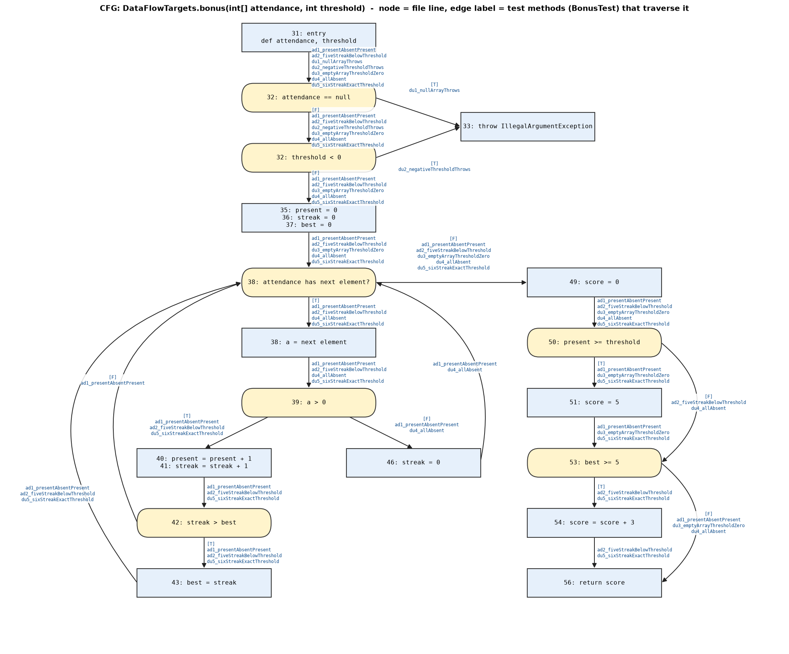

# Лаборатори №10: Өгөгдлийн урсгалын тест — Definition-Use хосууд

F.CSA313 — Программ хангамжийн чанарын баталгаа ба тест (2026)

- **Нэр:** А.Төгөлдөр
- **Оюутны код:** B242270001

Ажлын орчин: Windows 11 дээрх WSL2 (Ubuntu). Бүх `mvn` командыг WSL дотор `-B` (batch) горимоор ажиллуулсан —
эс бөгөөс `tee`-ээр хадгалсан гаралтад өнгөний ESC кодууд ордог.

```
$ java -version
openjdk version "25.0.4.1" 2026-08-18
OpenJDK Runtime Environment (build 25.0.4.1+1-1-26.04.4-Ubuntu)
OpenJDK 64-Bit Server VM (build 25.0.4.1+1-1-26.04.4-Ubuntu, mixed mode, sharing)

$ mvn -version
Apache Maven 3.9.12
Maven home: /usr/share/maven
Java version: 25.0.4.1, vendor: Ubuntu, runtime: /usr/lib/jvm/java-25-openjdk-amd64
Default locale: en, platform encoding: UTF-8
OS name: "linux", version: "6.18.33.2-microsoft-standard-wsl2", arch: "amd64", family: "unix"
```

Тэмдэглэгээ: `v(d → u)` — `v` хувьсагчийн `d` мөр дэх def-ээс `u` мөр дэх use хүртэлх DU хос.
Мөрийн дугаар бүр `src/main/java/mn/edu/must/sqat/DataFlowTargets.java` файлын мөр.
p-use-ийн хувьд `T` / `F` нь нөхцөлийн үнэн / худал салаа.

## Хэсэг A: gcd

### Def / Use

| Мөр | Код | Def | Use |
|---|---|---|---|
| 13 | `gcd(int x, int y)` | x, y | — |
| 15 | `while (y != 0)` | — | y (p-use) |
| 16 | `tmp = x % y;` | tmp | x (c-use), y (c-use) |
| 17 | `x = y;` | x | y (c-use) |
| 18 | `y = tmp;` | y | tmp (c-use) |
| 20 | `return x;` | — | x (c-use) |

14-р мөр (`int tmp;`) нь зөвхөн зарлалт, утга оноохгүй тул def биш.

### DU хосуудын хүснэгт

| № | Хувьсагч | Def мөр | Use мөр | c-use/p-use | Def-clear зам | Тестийн ID | Хамрагдсан |
|---|---|---|---|---|---|---|---|
| 1 | x | 13 | 16 | c-use | 13 → 15 → 16 | G2, G3 | Тийм |
| 2 | x | 13 | 20 | c-use | 13 → 15 → 20 | G1 | Тийм |
| 3 | x | 17 | 16 | c-use | 17 → 18 → 15 → 16 | G3 | Тийм |
| 4 | x | 17 | 20 | c-use | 17 → 18 → 15 → 20 | G2, G3 | Тийм |
| 5 | y | 13 | 15 (T) | p-use | 13 → 15 → 16 | G2, G3 | Тийм |
| 6 | y | 13 | 15 (F) | p-use | 13 → 15 → 20 | G1 | Тийм |
| 7 | y | 13 | 16 | c-use | 13 → 15 → 16 | G2, G3 | Тийм |
| 8 | y | 13 | 17 | c-use | 13 → 15 → 16 → 17 | G2, G3 | Тийм |
| 9 | y | 18 | 15 (T) | p-use | 18 → 15 → 16 | G3 | Тийм |
| 10 | y | 18 | 15 (F) | p-use | 18 → 15 → 20 | G2, G3 | Тийм |
| 11 | y | 18 | 16 | c-use | 18 → 15 → 16 | G3 | Тийм |
| 12 | y | 18 | 17 | c-use | 18 → 15 → 16 → 17 | G3 | Тийм |
| 13 | tmp | 16 | 18 | c-use | 16 → 17 → 18 | G2, G3 | Тийм |

Нийт 13 хос (x — 4, y — 8, tmp — 1), бүгд биелэх боломжтой, бүгд хамрагдсан.

DU хос биш хослолууд:

- `tmp(16 → 16)` гэж байхгүй: 16-р мөр tmp-г зөвхөн тодорхойлно, уншихгүй.
- `x(13 → 16)` хоёр дахь давталтад биелэхгүй: 17-р мөрийн `x = y` нь 13-ын def-ийг алдаг (kill).
  Иймд хоёр дахь давталтын 16-р мөр зөвхөн `x(17 → 16)`-г хамарна. y-ийн хувьд 18-р мөр мөн адил 13-ын def-ийг ална.

### Тестүүд (`src/test/java/mn/edu/must/sqat/GcdTest.java`)

| ID | Тестийн метод | Дуудлага | Хүлээх утга | Давталт | Хамарсан хосууд |
|---|---|---|---|---|---|
| G1 | `g1_zeroIterations_x13to20_y13to15F` | `gcd(7, 0)` | 7 | 0 | 2, 6 |
| G2 | `g2_oneIteration_x13to16_x17to20_y13to15T_y18to15F_tmp16to18` | `gcd(0, 5)` | 5 | 1 | 1, 4, 5, 7, 8, 10, 13 |
| G3 | `g3_twoIterations_x17to16_y18to15T_y18to16_y18to17` | `gcd(12, 8)` | 4 | 2 | 1, 3, 4, 5, 7, 8, 9, 10, 11, 12, 13 |

**gcd(7,0) ямар хосыг ганцаараа хамардаг вэ?** `x(13 → 20)` ба `y(13 → 15F)`. Параметрийн def давталтын
биед орохгүйгээр шууд return-д хүрэх цорын ганц зам нь анхны `y == 0` байх тохиолдол. Давталт нэг л удаа
эргэвэл 17, 18-р мөр x, y-г дахин тодорхойлж 13-ын def-ийг алдаг тул G2, G3 энэ хоёр хосыг хамарч чадахгүй.

**gcd(12,8) хэдэн давталт хийдэг вэ?** Хоёр: (x=12, y=8) → tmp=4, x=8, y=4 → tmp=0, x=4, y=0 → гарна.
Давталт дотор тодорхойлогдсон утга дараагийн давталтад хэрэглэгдэх `x(17 → 16)`, `y(18 → 15T)`,
`y(18 → 16)`, `y(18 → 17)` дөрвөн хос дор хаяж **хоёр** давталт шаардана; нэг давталттай G2 эдгээрийг хамардаггүй.
`x(17 → 20)`, `y(18 → 15F)`, `tmp(16 → 18)` болон 13-аас эхэлсэн 1, 5, 7, 8-р хосод нэг давталт хангалттай.

All-DU-pairs-д G1 + G3 хоёр тест л хангалттай (G3 нь G2-ын бүх хосыг хамарна). G2-г нэг давталтын тохиолдлыг
тусад нь харуулах, `gcd(0, y)` захын утгыг шалгах зорилгоор үлдээсэн.

## Хэсэг B: bonus

### B1 — CFG



Зангилаа бүр файлын мөрийн дугаартай; шар зангилаа — нөхцөл (p-use), цэнхэр — оноолт/мэдэгдэл.
38-р мөрийн for-each-ийг хоёр зангилаа болгосон: нөхцөл (attendance-д дараагийн элемент байгаа эсэх) ба алхам (`a` = дараагийн элемент).
32-р мөрийн `||` богино тооцоололтой тул мөн хоёр зангилаа. Ирмэгийн хажуу дахь нэрс нь тухайн ирмэгийг дайрдаг `BonusTest`-ийн методууд.

### B2 — Def / Use жагсаалт

```java
31: bonus(int[] attendance, int threshold)  // def: attendance, threshold
32: if (attendance == null || threshold < 0) // p-use: attendance, threshold
33:     throw new IllegalArgumentException   // —
35: int present = 0;                         // def: present
36: int streak = 0;                          // def: streak
37: int best = 0;                            // def: best
38: for (int a : attendance)                 // нөхцөл: p-use attendance (дараагийн элемент байгаа эсэх)
                                             // алхам:  c-use attendance (элемент унших), def: a
39:     if (a > 0)                           // p-use: a
40:         present = present + 1;           // c-use: present; def: present
41:         streak = streak + 1;             // c-use: streak;  def: streak
42:         if (streak > best)               // p-use: streak, best
43:             best = streak;               // c-use: streak;  def: best
46:         streak = 0;                      // def: streak   (KILL: streak-ийн 36, 41, 46-ын def)
49: int score = 0;                           // def: score
50: if (present >= threshold)                // p-use: present, threshold
51:     score = 5;                           // def: score    (KILL: score-ийн 49-ийн def)
53: if (best >= 5)                           // p-use: best
54:     score = score + 3;                   // c-use: score; def: score
56: return score;                            // c-use: score
```

32-р мөрийн `||` нь богино тооцоололтой: `attendance == null` үнэн бол `threshold < 0` огт тооцогдохгүй,
өөрөөр хэлбэл threshold-ийн 32 дахь p-use нь зөвхөн attendance-ийн p-use худал гарсны дараа биелнэ.

### B3 — DU хосуудын хүснэгт

| № | Хувьсагч | Def | Use | c/p-use | Def-clear зам | Тестийн ID | Хамрагдсан |
|---|---|---|---|---|---|---|---|
| 1 | attendance | 31 | 32 (T) | p-use | 31 → 32 → 33 | DU1 | Тийм |
| 2 | attendance | 31 | 32 (F) | p-use | 31 → 32 → 35 | AD1, AD2, DU2, DU3, DU4, DU5, DU6 | Тийм |
| 3 | attendance | 31 | 38 (T) | p-use | 31 → 32 → 35 → 36 → 37 → 38 → 39 | AD1, AD2, DU4, DU5, DU6 | Тийм |
| 4 | attendance | 31 | 38 (F) | p-use | 31 → 32 → 35 → 36 → 37 → 38 → 49 | AD1, AD2, DU3, DU4, DU5, DU6 | Тийм |
| 5 | attendance | 31 | 38 (алхам) | c-use | 31 → 32 → 35 → 36 → 37 → 38 | AD1, AD2, DU4, DU5, DU6 | Тийм |
| 6 | threshold | 31 | 32 (T) | p-use | 31 → 32 → 33 | DU2 | Тийм |
| 7 | threshold | 31 | 32 (F) | p-use | 31 → 32 → 35 | AD1, AD2, DU3, DU4, DU5, DU6 | Тийм |
| 8 | threshold | 31 | 50 (T) | p-use | 31 → 32 → 35 → … → 38 → 49 → 50 → 51 | AD1, DU3, DU5, DU6 | Тийм |
| 9 | threshold | 31 | 50 (F) | p-use | 31 → 32 → 35 → … → 38 → 49 → 50 → 53 | AD2, DU4 | Тийм |
| 10 | a | 38 | 39 (T) | p-use | 38 → 39 → 40 | AD1, AD2, DU5, DU6 | Тийм |
| 11 | a | 38 | 39 (F) | p-use | 38 → 39 → 46 | AD1, DU4, DU6 | Тийм |
| 12 | present | 35 | 40 | c-use | 35 → 36 → 37 → 38 → (39 → 46 → 38)* → 39 → 40 | AD1, AD2, DU5, DU6 | Тийм |
| 13 | present | 35 | 50 (T) | p-use | 35 → 36 → 37 → 38 → (39 → 46 → 38)* → 49 → 50 → 51 | DU3 | Тийм |
| 14 | present | 35 | 50 (F) | p-use | 35 → 36 → 37 → 38 → (39 → 46 → 38)* → 49 → 50 → 53 | DU4 | Тийм |
| 15 | present | 40 | 40 | c-use | 40 → 41 → 42 → (43) → 38 → (39 → 46 → 38)* → 39 → 40 | AD1, AD2, DU5, DU6 | Тийм |
| 16 | present | 40 | 50 (T) | p-use | 40 → 41 → 42 → (43) → 38 → (39 → 46 → 38)* → 49 → 50 → 51 | AD1, DU5, DU6 | Тийм |
| 17 | present | 40 | 50 (F) | p-use | 40 → 41 → 42 → (43) → 38 → (39 → 46 → 38)* → 49 → 50 → 53 | AD2 | Тийм |
| 18 | streak | 36 | 41 | c-use | 36 → 37 → 38 → 39 → 40 → 41 | AD1, AD2, DU5, DU6 | Тийм |
| 19 | streak | 41 | 41 | c-use | 41 → 42 → (43) → 38 → 39 → 40 → 41 | AD2, DU5, DU6 | Тийм |
| 20 | streak | 46 | 41 | c-use | 46 → 38 → 39 → 40 → 41 | AD1, DU6 | Тийм |
| 21 | streak | 41 | 42 (T) | p-use | 41 → 42 → 43 | AD1, AD2, DU5, DU6 | Тийм |
| 22 | streak | 41 | 42 (F) | p-use | 41 → 42 → 38 | AD1, DU6 | Тийм |
| 23 | streak | 41 | 43 | c-use | 41 → 42 → 43 | AD1, AD2, DU5, DU6 | Тийм |
| 24 | best | 37 | 42 (T) | p-use | 37 → 38 → (39 → 46 → 38)* → 39 → 40 → 41 → 42 → 43 | AD1, AD2, DU5, DU6 | Тийм |
| 25 | best | 37 | 42 (F) | p-use | — | — | **Биелэшгүй** |
| 26 | best | 37 | 53 (T) | p-use | — | — | **Биелэшгүй** |
| 27 | best | 37 | 53 (F) | p-use | 37 → 38 → (39 → 46 → 38)* → 49 → 50 → (51) → 53 → 56 | DU3, DU4 | Тийм |
| 28 | best | 43 | 42 (T) | p-use | 43 → 38 → 39 → 40 → 41 → 42 → 43 | AD2, DU5, DU6 | Тийм |
| 29 | best | 43 | 42 (F) | p-use | 43 → 38 → (39 → 46 → 38)* → 39 → 40 → 41 → 42 → 38 | AD1, DU6 | Тийм |
| 30 | best | 43 | 53 (T) | p-use | 43 → 38 → … → 49 → 50 → (51) → 53 → 54 | AD2, DU5 | Тийм |
| 31 | best | 43 | 53 (F) | p-use | 43 → 38 → … → 49 → 50 → (51) → 53 → 56 | AD1, DU6 | Тийм |
| 32 | score | 49 | 54 | c-use | 49 → 50 → 53 → 54 | AD2 | Тийм |
| 33 | score | 49 | 56 | c-use | 49 → 50 → 53 → 56 | DU4 | Тийм |
| 34 | score | 51 | 54 | c-use | 51 → 53 → 54 | DU5 | Тийм |
| 35 | score | 51 | 56 | c-use | 51 → 53 → 56 | AD1, DU3, DU6 | Тийм |
| 36 | score | 54 | 56 | c-use | 54 → 56 | AD2, DU5 | Тийм |

`(…)*` — тэг буюу түүнээс олон удаа давтагдана; `(43)`, `(51)` — дайрч ч, дайрахгүй ч болно.
Нийт 36 мөр: 34 нь биелэх боломжтой — бүгд хамрагдсан (34/34); 2 нь биелэшгүй.

**Kill тэмдэглэгээ**

- **Мөр 46 (`streak = 0`)** streak-ийн өмнөх гурван def-ийг бүгдийг ална: 36 (массивын эхний элемент тасалсан үед),
  41 (ирсэн өдрийн дараа тасалсан үед), 46 (хоёр дараалан тасалсан үед өмнөх `streak = 0`).
  46-ын def-ийн цорын ганц use нь 41 (хос 20).
- **Мөр 41 (`streak = streak + 1`)** мөн streak-ийн 36, 41, 46-ын def-ийг ална. 42, 43-р мөрийн use-д хүрэх зам бүр
  41-ийг заавал дайрдаг тул `streak(36 → 42)`, `streak(36 → 43)`, `streak(46 → 42)`, `streak(46 → 43)`
  дөрвөн хослол def-clear замгүй — **DU хос биш**, хүснэгтэд оруулаагүй.
- **Мөр 40** present-ийн 35 ба өмнөх 40-ийн def-ийг, **мөр 43** best-ийн 37 ба өмнөх 43-ын def-ийг ална.
- **Мөр 51 (`score = 5`)** score-ийн 49-ийн def-ийг ална: 50-ын нөхцөл үнэн бол `score = 0` хаана ч хэрэглэгдэлгүй дарагдана.
  Иймд 32, 33-р хос зөвхөн 50F замаар биелнэ.
- **Мөр 54** score-ийн 49 эсвэл 51-ийн def-ийг ална; `score(49 → 56)`, `score(51 → 56)` зөвхөн 53F замаар биелнэ.

**Биелэшгүй хосууд**

- **№25 `best(37 → 42F)`**: best 37-оос хойш дахин тодорхойлогдоогүй бол best = 0; 42-т хүрэхийн өмнө 41 заавал
  биелдэг тул streak ≥ 1, иймд `streak > best` үргэлж үнэн — F салаа гарах боломжгүй.
- **№26 `best(37 → 53T)`**: 37-ын def 53-т хүрсэн бол best = 0 хэвээр, `0 >= 5` хэзээ ч үнэн болохгүй.

### B4 — Шат 1: ALL-DEFS

All-defs шалгуур: def бүр дор хаяж нэг use-д def-clear замаар хүрэх ёстой. bonus-д 13 def бий:
attendance(31), threshold(31), present(35, 40), streak(36, 41, 46), best(37, 43), a(38), score(49, 51, 54).

**Хамгийн цөөн тест: 2.**

| ID | Тестийн метод | Дуудлага | Хүлээх утга | Use-д хүргэсэн def-үүд |
|---|---|---|---|---|
| AD1 | `ad1_presentAbsentPresent` | `bonus({1,0,1}, 1)` | 5 | attendance 31, threshold 31, present 35, 40, streak 36, 41, 46, best 37, 43, a 38, score 51 |
| AD2 | `ad2_fiveStreakBelowThreshold` | `bonus({1,1,1,1,1}, 6)` | 3 | score 49, 54 (+ AD1-ийн ихэнх def дахин) |

**Яагаад нэг тест хүрэлцэхгүй вэ?** score-ийн 49 ба 51-ийн def-ийг нэг гүйцэтгэлд хоёуланг нь use-д хүргэж болохгүй.
49-ийн def-ийн use нь 54, 56; тэдэнд def-clear замаар хүрэхийн тулд 51-ийг алгасах, өөрөөр хэлбэл 50-ын нөхцөл
**худал** байх ёстой. 51-ийн def өөрөө зөвхөн 50-ын нөхцөл **үнэн** үед л биелнэ. 50-р мөр нэг дуудлагад ганц л удаа
биелдэг (давталтын гадна) тул хоёр нөхцөлийг нэг гүйцэтгэл хангаж чадахгүй — дор хаяж 2 тест хэрэгтэй.
Дээрх хоёр тест үлдсэн 11 def-ийг бүгдийг хамарч байгаа тул 2 нь хангалттай.

AD1-д `{1,0,1}` сонгосон шалтгаан: streak-ийн 46-ын def use-д хүрэхийн тулд тасалсан өдрийн **дараа** ирсэн өдөр
байх ёстой (46 → 41), 36-ын def use-д хүрэхийн тулд **эхний** элемент ирсэн байх ёстой (эс бөгөөс 46 түүнийг ална).

All-defs шатны үр дүн (`results/mvn-verify-alldefs.txt`, `results/jacoco-alldefs.csv`):

| Үзүүлэлт | Утга |
|---|---|
| Tests run | 5 (GcdTest 3 + BonusTest 2), Failures 0, Errors 0 |
| BRANCH_MISSED / BRANCH_COVERED | 2 / 14 (14/16) |
| LINE_MISSED / LINE_COVERED | 2 / 22 |

Хамрагдаагүй 2 салаа нь 32-р мөрийн `attendance == null` ба `threshold < 0` нөхцөлийн үнэн салаа,
хамрагдаагүй 2 мөр нь 7 (далд constructor) ба 33 (`throw`).

### B4 — Шат 2: ALL-DU-PAIRS

All-defs-ийн дараа хүснэгтэд 7 хос хамрагдаагүй үлдсэн: №1, 6, 13, 14, 27, 33, 34. Тэдгээрийг хамруулахаар 5 тест нэмсэн:

| ID | Тестийн метод | Дуудлага | Хүлээх утга | Шинээр хамарсан хосууд |
|---|---|---|---|---|
| DU1 | `du1_nullArrayThrows` | `bonus(null, 1)` | IllegalArgumentException | №1 attendance(31 → 32T) |
| DU2 | `du2_negativeThresholdThrows` | `bonus({1}, -1)` | IllegalArgumentException | №6 threshold(31 → 32T) |
| DU3 | `du3_emptyArrayThresholdZero` | `bonus({}, 0)` | 5 | №13 present(35 → 50T), №27 best(37 → 53F) |
| DU4 | `du4_allAbsent` | `bonus({0,0,0}, 1)` | 0 | №14 present(35 → 50F), №33 score(49 → 56) |
| DU5 | `du5_sixStreakExactThreshold` | `bonus({1,1,1,1,1,1}, 6)` | 8 | №34 score(51 → 54) |

- №13, 14 (present-ийн 35-ын def шууд 50-д хүрэх) нь 40-р мөр нэг ч удаа биелээгүй, өөрөөр хэлбэл ирсэн өдөр огт байхгүй үед л
  биелнэ; T салаанд `0 >= threshold` үнэн байх ёстой тул threshold = 0 (DU3), F салаанд threshold > 0 (DU4).
- №33 score(49 → 56) нь 50F ба 53F хоёулаа, №34 score(51 → 54) нь 50T ба 53T хоёулаа байхыг шаардана — AD1 (T, F), AD2 (F, T)
  хоёрт байгаагүй хослолууд.
- DU4-д 46-р мөр гурван удаа дараалан биелж, эхний удаад 36-ын def-ийг, дараагийн хоёрт өмнөх 46-ын def-ийг ална (use-гүй def).

Энэ шатны дараа: Tests run 10 (GcdTest 3 + BonusTest 7), биелэх боломжтой 34 хос бүгд хамрагдсан.

### B5 — JaCoCo: branch хамралт ба DU хамралт

| Шат | Файл | Tests run | BRANCH_MISSED / COVERED | LINE_MISSED / COVERED |
|---|---|---|---|---|
| All-defs | `results/mvn-verify-alldefs.txt`, `results/jacoco-alldefs.csv` | 5 | 2 / 14 (14/16) | 2 / 22 |
| Эцсийн (Хэсэг C-гийн дараа) | `results/mvn-verify-final.txt`, `results/jacoco-final.csv` | 11 | 0 / 16 (16/16) | 1 / 23 |

Эцсийн `LINE_MISSED = 1` нь 7-р мөр — `DataFlowTargets` классын далд constructor; тест бичээгүй, кодыг өөрчлөөгүй.
Эцсийн 11 тест = GcdTest 3 + BonusTest 8 (AD1, AD2, DU1–DU5, мөн Хэсэг C-д нэмсэн DU6).

**All-defs хангагдсан ч branch 100% биш байж болох уу?** Болно, яг тэгсэн: all-defs шатанд 13 def бүгд use-д хүрсэн атал
Branch 14/16 байв. Хамрагдаагүй хоёр салаа нь 32-р мөрийн хоёр нөхцөлийн үнэн салаа (→ 33 `throw`). All-defs нь def бүрээс
**нэг** use-д хүрэхийг л шаарддаг: attendance, threshold-ийн def 32-ын F салаа болон 38, 50-р мөрийн use-ээр аль хэдийн
"хэрэглэгдсэн" тул T салааг дайрах шаардлага гараагүй.

**Branch 100% болсон мөчид хамрагдаагүй DU хос үлдэж болох уу?** Болно. All-defs-ийн хоёр тест дээр зөвхөн DU1 (`bonus(null, 1)`) ба
DU2 (`bonus({1}, -1)`)-ыг нэмэхэд (bonus-д нийт 4 тест) Branch аль хэдийн 16/16 болдог —
`results/jacoco-branch100-4tests.csv`: BRANCH_MISSED = 0, BRANCH_COVERED = 16. Гэтэл DU хүснэгтэд 5 хос хамрагдаагүй хэвээр:

| № | Хос | Яагаад branch хамралт үүнийг шаардахгүй вэ |
|---|---|---|
| 13 | present(35 → 50T) | 50T салааг AD1 аль хэдийн дайрсан — гэхдээ present-ийн 40-ийн def-ээр, 35-ынхаар биш |
| 14 | present(35 → 50F) | 50F салааг AD2 дайрсан — мөн 40-ийн def-ээр |
| 27 | best(37 → 53F) | 53F салааг AD1 дайрсан — best-ийн 43-ын def-ээр |
| 33 | score(49 → 56) | 50F ба 53F салаа тус тусдаа хамрагдсан (AD2, AD1), харин нэг гүйцэтгэлд хамт биш |
| 34 | score(51 → 54) | 50T ба 53T салаа тус тусдаа хамрагдсан (AD1, AD2), харин нэг гүйцэтгэлд хамт биш |

Branch хамралт салаа бүрийг **тусад нь** нэг удаа дайрсан эсэхийг л тоолдог; тэр салаанд **аль def-ийн утга** хүрсэн,
салаануудын **ямар хослол** нэг замд таарсныг хэмждэггүй. Жишээ нь №33, 34 нь 50 ба 53-ын салаануудын хослол (F,F) ба (T,T) —
score-ийн "0 оноо" ба "8 оноо" гэсэн хоёр гаралт. Branch 100% байхад эдгээр гаралтыг нэг ч тест шалгаагүй байсан.
Иймд JaCoCo-гийн 16/16 нь DU хамралтын талаар юу ч хэлэхгүй; DU хүснэгт л үүнийг харуулна.

## Хэсэг C: Fault seeding

Мутаци бүрийг `DataFlowTargets.java` дээр шууд хийж, `mvn -B test` ажиллуулаад `git restore`-оор буцаасан
(мутацийг commit хийгээгүй). M1, M2-ыг all-DU-pairs шатны 10 тестээр, M2-kill ба M3-ыг DU6 нэмэгдсэн 11 тестээр ажиллуулсан.

| № | Мутаци | Файл | Tests run / Failures | Унасан тест | expected / was | Үр дүн |
|---|---|---|---|---|---|---|
| M1 | 41-р мөр `streak = streak + 1;` устгасан | `results/mvn-test-M1.txt` | 10 / 2 | `BonusTest.ad2_fiveStreakBelowThreshold:27` | `expected: <3> but was: <0>` | Баригдсан |
|  |  |  |  | `BonusTest.du5_sixStreakExactThreshold:59` | `expected: <8> but was: <5>` |  |
| M2 | 42–44-р мөр → `best = present;` | `results/mvn-test-M2.txt` | 10 / 0 | — | — | **Амьд үлдсэн** |
| M2 + DU6 | M2 хэвээр, `du6_streakBrokenInMiddle` нэмсэн | `results/mvn-test-M2-kill.txt` | 11 / 1 | `BonusTest.du6_streakBrokenInMiddle:67` | `expected: <5> but was: <8>` | Баригдсан |
| M3 | Давталтын дараа `int total = present + best;` нэмсэн | `results/mvn-test-M3.txt` | 11 / 0 | — | — | **Амьд үлдсэн** (тестээр баригдахгүй) |

### M1 — missing update

`streak = streak + 1` байхгүй болоход streak-ийн 36-ын def (0) хэзээ ч шинэчлэгдэхгүй, `streak > best` (0 > 0) үргэлж худал,
best = 0 хэвээр үлдэнэ. Иймд "цуваа ≥ 5 бол +3" оноо хэзээ ч нэмэгдэхгүй: best(43 → 53T) хосыг хамардаг хоёр тест —
AD2 (3 биш 0) ба DU5 (8 биш 5) унасан. Бусад 8 тестэд best < 5 байх ёстой тул гаралт өөрчлөгдөөгүй.

### M2 — wrong variable: бүх хос хамрагдсан атал яагаад амьд үлдэв?

All-DU-pairs шатны 7 bonus тестэд best шинэчлэгдэх мөчид present ба streak-ийн утга нь **ижил**, эсвэл ялгаатай ч
гаралтад нөлөөлөхгүй байсан:

| Тест | Оролт | Зөв код: best | M2: best (= present) | `best >= 5` | Гаралт |
|---|---|---|---|---|---|
| AD1 | `{1,0,1}`, 1 | 1 | 2 | хоёуланд худал | 5 = 5 |
| AD2 | `{1,1,1,1,1}`, 6 | 5 | 5 | хоёуланд үнэн | 3 = 3 |
| DU3 | `{}`, 0 | 0 | 0 | худал | 5 = 5 |
| DU4 | `{0,0,0}`, 1 | 0 | 0 | худал | 0 = 0 |
| DU5 | `{1,1,1,1,1,1}`, 6 | 6 | 6 | үнэн | 8 = 8 |

Тасралтгүй цуваатай массивт (AD2, DU5) алхам бүрд present == streak тул `best = present` ба `best = streak` яг ижил утга онооно.
Цуваа тасардаг цорын ганц тест AD1-д present (2) ба хамгийн урт цуваа (1) ялгаатай болсон ч хоёулаа 5-аас бага тул
53-ын p-use ижил салаагаар явж, алдаа гаралтад хүрээгүй. Өөрөөр хэлбэл DU хамралт нь def-ээс use хүртэлх **замыг** дайрахыг л
шаарддаг, тэр замаар урсах **утга** нь алдаатай кодод өөр байх, тэр ялгаа гаралтад хүрэхийг шаарддаггүй.

**Унагасан тест:** `du6_streakBrokenInMiddle` — `bonus({1,1,1,0,1,1}, 5)`, хүлээх утга 5. Нийт ирц 5 (≥ 5), харин хамгийн урт
цуваа 3 (< 5). Зөв кодод best = 3 → +3 оноо нэмэгдэхгүй → 5. M2-т best = present = 5 → `best >= 5` үнэн → 8.
`results/mvn-test-M2-kill.txt`: `BonusTest.du6_streakBrokenInMiddle:67 expected: <5> but was: <8>`.
Энэ тест шинэ DU хос хамраагүй (бүгд аль хэдийн хамрагдсан байсан) — зөвхөн present ≥ 5 > хамгийн урт цуваа байх утгыг сонгосноор барьсан.

### M3 — dead definition

`total`-ийн def (давталтын дараах шинэ мөр) нэг ч use-гүй тул программын гаралт огт өөрчлөгдөхгүй — ямар ч тест,
ямар ч оролтоор үүнийг унагах боломжгүй (11 тест бүгд ногоон). Динамик тест зөвхөн ажиглагдах зан төлөвийг шалгадаг;
use-гүй def бол зан төлөвийн биш, **бүтцийн** гажиг (DU хүснэгтэд `total` нь нэг ч хосгүй def болж харагдана — all-defs шалгуур
биелэх боломжгүй болно).

javac ч анхааруулдаггүй: мутацитай файл дээр `javac -Xlint:all` ажиллуулахад ямар ч гаралтгүй, exit код 0 байсан
(Maven-ий compile алхам ч WARNING өгөөгүй — `results/mvn-test-M3.txt`).

Үүнийг барих багаж бол **статик анализ** (өгөгдлийн урсгалын гажилт — "defined but never used" илрүүлэгч): IDE-ийн инспекц,
SpotBugs (`DLS_DEAD_LOCAL_STORE`), PMD (`UnusedLocalVariable`), SonarLint. VS Code-ийн Java өргөтгөл (Eclipse JDT) мутацитай файл дээр
дараах анхааруулгыг өгсөн:

```
1. WARNING in ...\src\main\java\mn\edu\must\sqat\DataFlowTargets.java (at line 49)
	int total = present + best;
	    ^^^^^
The value of the local variable total is not used
```

Гурван мутацийн дараа `git restore` хийсэн; `git diff f5e075f HEAD -- src/main` хоосон (эх код starter-тэй ижил).

## Дүгнэлт

DU анализ нь branch хамралтаас илүү нарийн шалгуур: branch хамралт салаа бүрийг нэг удаа дайрахад л хангагддаг бол DU анализ
утга хаана үүсээд хаана хэрэглэгдэж байгааг, өөрөөр хэлбэл салаануудын аль хослол нэг замд таарах ёстойг шаарддаг.
Энэ лабд bonus-ийн дөрвөн тестээр branch хамралт 16/16 болсон ч 5 DU хос хамрагдаагүй үлдсэн нь, тэдгээрийн дунд 0 ба 8 оноо буцаах
замууд байсан нь үүний шууд баталгаа. Нөгөө талаас DU анализ үнэтэй: gcd шиг 6 мөр кодод 13 хос, bonus-д 36 мөр хүснэгт гарсан бөгөөд
хос бүрийн def-clear зам, kill, биелэх эсэхийг гараар шалгах шаардлагатай, JaCoCo шиг автоматаар хэмжих багаж байхгүй.
All-DU-pairs ч бүх алдааг барьдаггүй: M2 мутаци 34 хос бүгд хамрагдсан байхад амьд үлдсэн, учир нь шалгуур замыг дайрахыг шаарддаг
болохоос алдаатай утга гаралтад хүрэхийг шаарддаггүй — тестийн оролтын утгыг (present ≥ 5 > хамгийн урт цуваа) зориуд сонгож байж барьсан.
M3 шиг use-гүй def-ийг ямар ч тест барихгүй, үүнд статик анализ хэрэгтэй — динамик тест ба статик анализ бие биеэ нөхдөг.
Хамгийн их цаг авсан алхам нь B3 — bonus-ийн DU хүснэгт: давталт доторх streak, best-ийн def аль use-д хүрэхээсээ өмнө алагддагийг
(41, 46-р мөрийн kill) ялгах, биелэшгүй хоёр хосыг үндэслэх нь тест бичихээс хамаагүй удаан байсан.
